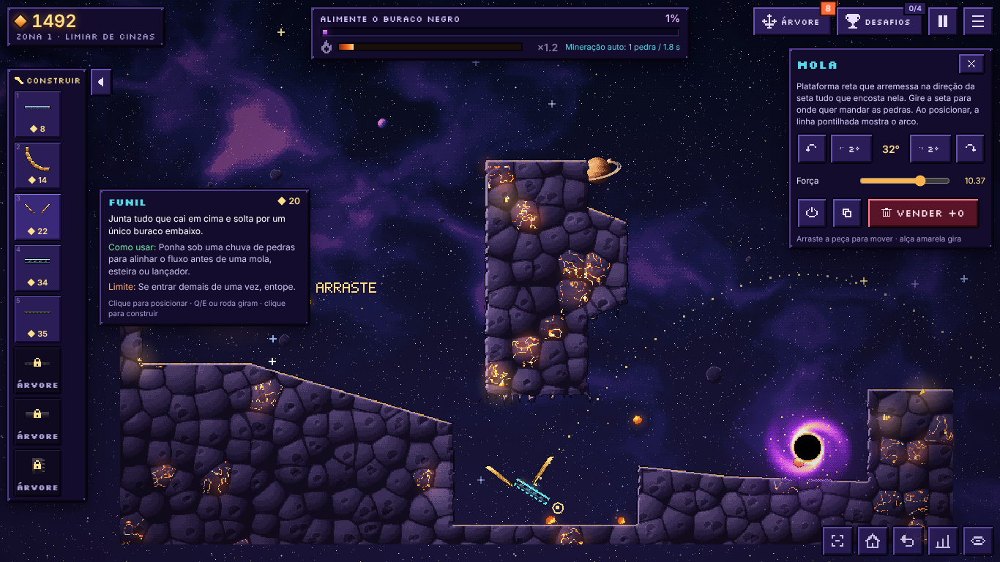

# Meteor Mill

Quebre um asteroide gigante, solte fragmentos com física própria e invente caminhos ao redor de rochas indestrutíveis até alimentar o buraco negro.

Jogo 2D de física/engenharia em pixel art procedural, com trilha original gerada por Web Audio. Implementado a partir da *Bíblia de Design / Prompt Mestre v1.0*.



## Visual

- Arte 100% procedural em pixel art: ilhas de rocha com silhueta orgânica (blocos, borda iluminada, poeira no topo, gotejamentos pendentes e cristais luminosos), asteroide com fissuras e minério que pulsam, disco de acreção em espiral animado, fragmentos como minério facetado.
- Céu em degradê pontilhado, nebulosa com fiapos, galáxia, planetas com anéis, rochas distantes em paralaxe e rochas de moldura em primeiro plano (fora do mapa).
- Camada de luz aditiva (bloom discreto) sem borrar contornos; vinheta.
- Escala de pixel adaptativa: o mapa inteiro aparece perto de 1:1, sem reamostrar a arte para baixo.
- Interface em vidro violeta com fonte Silkscreen nos títulos e Inter nos números e textos (ambas OFL, empacotadas — funcionam offline). Capturas em `docs/screens/`.

## Rodar

```bash
npm install
npm run dev      # servidor de desenvolvimento (http://localhost:5173)
npm run build    # typecheck + build estático em dist/ (funciona offline depois de carregado)
npm test         # testes de aceitação (vitest)
```

Stack: TypeScript + Vite + Canvas 2D + Matter.js. Sem servidor, sem assets externos: toda a arte e o áudio são gerados por código.

## História

Você trabalha para a **Singularis**, empresa que comprou o sistema **Ônix**, cinco planetas orbitando um buraco negro. Em cada planeta a empresa planta uma *semente de singularidade*; seu drone quebra a rocha e você leva os fragmentos até a semente, que cresce até engolir o canteiro e fazer o planeta cair em Ônix. O contrato segue do planeta mais próximo (I · Cinza) ao mais distante (V · Horizonte). Nos planetas IV e V os obstáculos são ruínas dos *Construtores*, uma civilização que fazia o mesmo trabalho e parou de repente.

- Memorandos da Diretora Vega: contrato ao começar, briefing ao chegar em cada planeta e relatório quando ele é entregue.
- Mapa do sistema com Ônix no centro e as órbitas dos planetas (substitui a lista de zonas).
- Ao entregar um planeta, metade do valor das peças instaladas é recuperada em créditos.

## Como se joga

- **Meta:** alimente o buraco negro. Ele cresce em tempo real; quando a barra enche, engole o mapa e você segue para o próximo, maior.
- **Calor (×):** entregas seguidas aquecem o buraco negro e multiplicam massa e créditos (×3, até ×6 com a árvore). Ele esfria sozinho — fluxo contínuo rende muito mais que entregar uma a uma.
- **Árvore estelar:** árvore de ~40 nós comprados com créditos. Libera as peças (só a Placa vem liberada), a **mineração automática** do asteroide e melhorias de calor, feixe, campos e economia. Alguns nós exigem chegar a certa zona.
- **Peças:** Viga orbital, Trilho curvo, Coletor, Placa de pulso, Esteira magnética, Acelerador linear, Canhão de massa, Amortecedor inercial, Comporta, Soprador iônico, Poço gravitacional, Repulsor, Braço robótico, Elevador gravitacional e Sensor de passagem. A placa de pulso perde força com a massa (pedras densas mal sobem); o canhão de massa dispara qualquer pedra com a mesma velocidade. Os dois mostram o arco pontilhado ao posicionar; peças direcionais têm seta.
- **Desafios:** objetivos opcionais por zona que pagam créditos.
- Créditos são globais (valem em todas as zonas); cada zona guarda sua instalação.

## O que está implementado

- Física com Matter.js (passo fixo, subpassos, colisões reais), feixe manual de força limitada, buraco negro com oclusão por rocha e crescimento, terreno indestrutível validado.
- Arte 100% procedural em pixel art: paredes como aglomerados de meteoros com veios de magma (alvenaria antiga com glifos acesos nos planetas IV e V), asteroide com minério pulsante, disco de acreção animado, fundo vivo (estrelas cintilantes, meteoros e estrelas cadentes, planeta girando com lua, galáxia, nebulosa à deriva), bloom aditivo e vinheta.
- Mineração a laser: um drone orbita o asteroide e dispara onde você mira; cursores próprios no PC (mira que se fecha no disparo, garra que abre sobre uma pedra e fecha ao segurar).
- Colapso final animado (o buraco negro engole o mapa) e tela "Supermassivo!".
- Interface com molduras pixel 9-slice, fonte Silkscreen nos títulos e Inter nos números (OFL, empacotadas), barra de construção à esquerda com fichas explicativas, HUD com barra do buraco negro e medidor de calor, tela de título com cena própria.
- Música original procedural (Web Audio) e efeitos sintetizados; save com migração (v3) e cópia de segurança; controles PC e toque em paisagem.

## Soluções de referência e testes

Cada zona documenta em `src/world/zones/zoneN.json` ao menos duas estratégias automatizadas (mais uma manual), e `tests/zones.test.ts` as simula de verdade no motor físico, além de verificar que sem peças nada chega ao buraco negro. As taxas medidas (entregues/gerados, com ritmo de cliques sustentável):

| Zona | Estratégia A | Estratégia B |
| --- | --- | --- |
| 1 | vigas sobre o fosso (~95%) | coletor + placa de pulso (~98%) |
| 2 | canhão com anteparo (~35–50%) | ponte + acelerador + canhão (~25–35%) |
| 3 | vigas sobre o poço + canhão (~75–95%) | esteiras + canhão (~60–85%) |
| 4 | dois canhões de massa: sobre a muralha e do bolso para a câmara (~60–80%) | placas de pulso + vento iônico, só pedras leves (~25–40%) |
| 5 | canhão no desfiladeiro (~40%) | elevador + soprador (~25–55%) |

Ferramentas de desenvolvimento em `tools/`: `simzone.ts` (simula e gera SVG de trajetórias), `optimize.ts` + `templates.ts` (busca de posições), `validate.ts`, e scripts Playwright de captura/interação.

## Limitações conhecidas

- Os preços, metas e durações são hipóteses de balanceamento; precisam de playtest humano (Marco G). As metas de eficiência das zonas 4–5 exigem combinar estratégias além das soluções de referência.
- O orçamento de corpos ativos é fixo (110 em toque, 200 no PC), não calibrado por benchmark em aparelho real.
- Testado em Chromium (desktop e emulação de iPhone em paisagem); não testado em Safari/Firefox nem em aparelho físico.
- Sem traduções além do português (textos centralizados nos módulos de UI).
